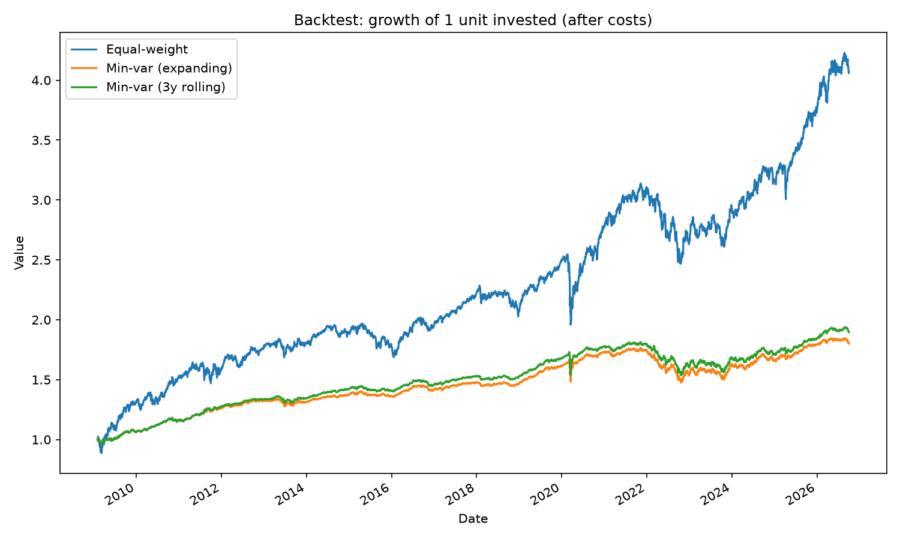
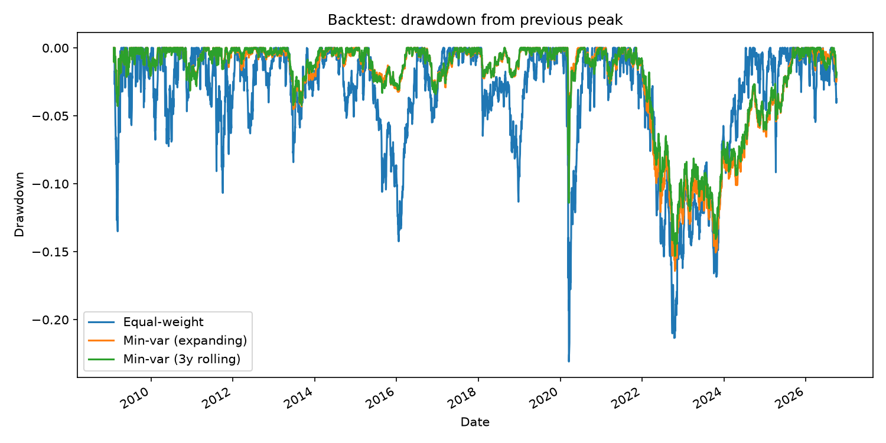
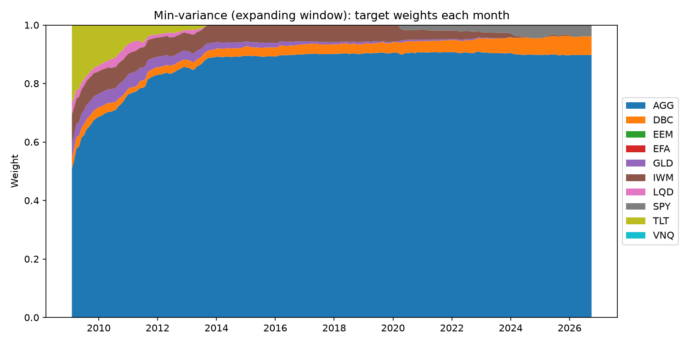

# Portfolio Optimisation and Backtesting

A Python research project comparing **equal-weight** and **minimum-variance** portfolios across ten ETFs, tested with a **walk-forward backtest** (monthly rebalancing, transaction costs, no look-ahead bias).

**Question:** If you split money across a diversified set of ETFs, does a portfolio optimiser that minimises risk hold up when it is tested honestly, using only the information available at each point in time?

**Short answer:** It cut risk and crash losses substantially, but it earned much less, and on a risk-adjusted basis (Sharpe ratio) equal-weight came out ahead in this sample. The optimiser's apparent advantage on the full history did not survive the walk-forward test.

---

## Data

- Ten US-listed ETFs from Yahoo Finance (`yfinance`), daily adjusted close prices, January 2007 to October 2026.
- Universe: SPY (US large-cap), IWM (US small-cap), EFA (developed ex-US), EEM (emerging markets), AGG (US aggregate bonds), TLT (long Treasuries), LQD (investment-grade credit), GLD (gold), DBC (commodities), VNQ (US real estate).
- Risk-free rate: US 13-week T-bill yield (`^IRX`), converted to a daily rate.

## Method

**Step 1: Data and returns** (`01_data_and_returns.py`)
Downloads prices, computes daily simple returns, and reports annualised return, volatility and the correlation matrix.

**Step 2: Optimisation** (`02_optimisation.py`)
Finds the long-only, fully-invested weights that minimise portfolio variance (`scipy.optimize`, SLSQP) and compares them with an equal-weight portfolio. Also traces the efficient frontier. **This step is in-sample**: It uses the full history to choose weights and then judges them on the same history, so it is for understanding, not for evaluating performance.

**Step 3: Walk-forward backtest** (`03_backtest.py`)
On the first trading day of each month, each strategy chooses weights using only returns from *before* that day, then holds them (letting weights drift with prices) until the next rebalance, paying a transaction cost on whatever it trades.

| Strategy | Weights chosen by |
|---|---|
| Equal-weight | 10% in each ETF, reset monthly |
| Min-variance (expanding) | Lowest-volatility long-only mix, using all data available so far |
| Min-variance (3y rolling) | Lowest-volatility long-only mix, using only the most recent 3 years |

Settings: transaction cost of 0.1% of each unit traded; the first 504 trading days (around 2 years) are used only to estimate weights, so trading starts in February 2009.

**No look-ahead check** (`test_no_lookahead.py`)
Scrambles all returns after a chosen date and confirms that every weight and return before that date is unchanged. Run `python test_no_lookahead.py`.

## Results

Backtest period: 2 February 2009 to 2 October 2026. Average risk-free rate over the period: 1.39% a year. All figures are after transaction costs.

| | Ann. return | Ann. volatility | Sharpe | Sharpe (rf=0) | Max drawdown | Daily VaR 95% | Daily ES 95% | Annual turnover |
|---|---|---|---|---|---|---|---|---|
| Equal-weight | 8.28% | 10.98% | 0.65 | 0.78 | -23.08% | 1.02% | 1.62% | 31% |
| Min-var (expanding) | 3.40% | 4.72% | 0.44 | 0.73 | -16.42% | 0.43% | 0.69% | 15% |
| Min-var (3y rolling) | 3.70% | 4.70% | 0.50 | 0.80 | -15.31% | 0.42% | 0.69% | 36% |

Stress periods (total return):

| | Equal-weight | Min-var (expanding) | Min-var (3y rolling) |
|---|---|---|---|
| COVID crash (19 Feb to 23 Mar 2020) | -21.5% | -4.7% | -5.3% |
| 2022 (bonds and equities both fell) | -14.6% | -12.0% | -10.9% |





### What the results show

1. **Minimum-variance reduced risk substantially, as intended.** It roughly halved volatility, cut the maximum drawdown from 23% to 15-16%, and lost about 5% in the COVID crash against 21.5% for equal-weight.
2. **The lower risk was reflected in lower returns.** It earned 3.4-3.7% a year against 8.3%, because it was concentrated in aggregate bonds (about 90% by 2014), which returned little over this period.
3. **Equal-weight achieved a higher Sharpe ratio** (0.65 against 0.44-0.50). The ranking was different at a 0% risk-free rate (0.78, 0.73, 0.80), so the conclusion depends on this assumption. The differences are also small relative to the statistical uncertainty of a 17-year sample, so I treat as suggestive, not conclusive.
4. **Low risk is not no risk.** In 2022, bonds and equities fell together and min-variance still lost 11-12%. The optimiser relies on past correlations, which are not stable in a crisis.
5. **The in-sample result did not carry over.** On the full history, min-variance looked better on return per unit of risk. Once weights were chosen using only past data, that advantage disappeared.
6. **Transaction costs were not a driver** at 0.1% per trade: turnover of 15-36% a year costs only a few hundredths of a percent.

Expanding and rolling windows performed similarly, and I do not read anything into the small difference between them.

## Limitations

- **One historical path.** Seventeen years of data is a limited sample, and the ranking could differ in other periods (for example a long equity bear market).
- **The backtest starts in 2009**, because the first two years are used for estimation, so the main 2008 crash is not in the test period.
- **Survivorship and selection bias.** The ETFs are ones that exist today with long histories. Funds that closed, and asset classes that fell out of favour, are not represented.
- **US-listed, USD-priced ETFs.** A UK investor would normally hold UCITS funds and measure returns in GBP. I chose this universe for history length and data quality. Currency risk is ignored.
- **Risk-free rate is a proxy.** `^IRX` is a quoted T-bill yield, not a perfect measure of a risk-free return.
- **Simple assumptions.** A flat 0.1% trading cost, no taxes, no market impact, and sample covariance estimates with no shrinkage.
- **Sharpe ratios are not statistically tested.** Differences of about 0.1-0.2 are within normal estimation error.

## Possible extensions

- Shrinkage covariance (Ledoit-Wolf) to stabilise the minimum-variance weights.
- A risk-parity or maximum-Sharpe strategy for comparison.
- Cost sensitivity (0%, 0.1%, 0.5%) and different rebalancing frequencies.
- A GBP / UCITS version using `GBPUSD=X` and a UK risk-free rate.
- A factor-attribution step using Fama-French factors.

## How to run

Requires Python 3.11 or later.

```
pip install -r requirements.txt
python 01_data_and_returns.py
python 02_optimisation.py
python 03_backtest.py
python test_no_lookahead.py
```

Charts are saved to `figures/` and downloaded data to `data/`. Re-running the scripts uses the saved data. Delete `data/prices.csv` to download fresh prices.

## Project structure

```
01_data_and_returns.py   download prices, compute returns, risk and correlation
02_optimisation.py       equal-weight vs minimum-variance, efficient frontier (in-sample)
03_backtest.py           walk-forward backtest, performance and risk measures
test_no_lookahead.py     check that decisions never use future data
requirements.txt         Python packages
figures/                 saved charts
```

## Disclaimer

This is an educational research project, not investment advice. Past performance does not predict future results.
